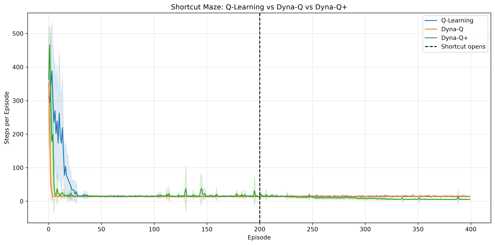

# Dynamic Maze: Reinforcement Learning with Dyna-Q+

A reinforcement learning project comparing **Q-Learning, Dyna-Q, and Dyna-Q+** in static and dynamically changing grid-world environments.

The project explores how model-based planning and exploration bonuses affect an agent's ability to learn efficient paths and adapt when obstacles change.

## Overview

Traditional reinforcement learning agents learn from direct interactions with their environment. Model-based methods such as Dyna-Q additionally use simulated experiences to accelerate learning.

However, when an environment changes, previously learned information may become outdated.

This project investigates three approaches:

- **Q-Learning:** Model-free reinforcement learning using temporal-difference updates.
- **Dyna-Q:** Model-based reinforcement learning combining Q-learning with simulated planning.
- **Dyna-Q+:** Extends Dyna-Q with exploration bonuses that encourage revisiting actions not attempted recently.

All three algorithms are implemented in Python using NumPy.

## Features

- Custom grid-world maze environment
- Configurable start positions, goals, and obstacles
- Q-Learning, Dyna-Q, and Dyna-Q+ implementations
- Dynamic obstacle changes during training
- Blocking and shortcut experiments
- Epsilon-greedy action selection
- Greedy policy evaluation
- Multi-seed experiments for reproducibility
- Learning-curve visualization using Matplotlib
- Automated unit tests
- CSV export of experimental results

## Algorithms

### 1. Q-Learning

Q-Learning updates action values using the Bellman optimality target:

\[
Q(s,a) \leftarrow Q(s,a) + \alpha \left[r + \gamma \max_{a'}Q(s',a') - Q(s,a)\right]
\]

For terminal transitions, the future-value term is omitted.

Q-Learning learns directly from real environment interactions without constructing an environment model.

### 2. Dyna-Q

Dyna-Q combines direct reinforcement learning with model-based planning.

After each real interaction, the agent:

1. Updates its Q-table.
2. Stores the observed transition in a model.
3. Samples previously observed transitions.
4. Performs additional Q-learning updates using those simulated experiences.

This allows the agent to reuse previous experiences and potentially learn faster.

### 3. Dyna-Q+

Dyna-Q+ extends Dyna-Q by introducing an exploration bonus during planning:

\[
r_{\text{planning}} = r + \kappa\sqrt{\tau(s,a)}
\]

Where:

- \(r\) is the modeled reward.
- \(\kappa\) controls the exploration bonus.
- \(\tau(s,a)\) measures the number of real interactions since action \(a\) was last executed in state \(s\).

When a state is first encountered, the model initializes transitions for all available actions, including actions not yet attempted.

The exploration bonus increases for actions that have not been tried recently, encouraging the agent to reconsider potentially outdated information.

## Environments and Experiments

### Static Maze

Agents learn to navigate a maze with fixed obstacles.

This experiment provides a baseline for evaluating learning speed and path efficiency.

### Blocking Maze

An additional obstacle appears during training, blocking a previously available route.

The agents must adapt their policies to reach the goal using an alternative path.

### Shortcut Maze

An obstacle is removed during training, creating a shorter route to the goal.

The experiment evaluates whether agents discover and exploit the newly available shortcut.

**Shortcut experiment configuration:**

| Parameter | Value |
|---|---|
| Grid size | 6 × 9 |
| Start | (5, 4) |
| Goal | (0, 4) |
| Training episodes | 400 |
| Environment change | Episode 200 |
| Maximum steps per episode | 500 |
| Random seeds | 10 |
| Learning rate | 0.1 |
| Discount factor | 0.95 |
| Epsilon | 0.1 |
| Planning steps | 10 |
| Dyna-Q+ exploration coefficient | 0.001 |

Before the obstacle is removed, the shortest route requires 13 steps. After the shortcut opens, the optimal route requires only 5 steps.

## Experimental Results

The shortcut experiment was repeated across 10 random seeds.

### Average Steps per Episode

| Algorithm | Before Change (150–199) | After Change (200–249) | Final 50 Episodes |
|---|---:|---:|---:|
| Q-Learning | 14.78 | 14.76 | 14.67 |
| Dyna-Q | 14.62 | 14.54 | 14.83 |
| **Dyna-Q+** | **15.99** | **14.30** | **5.96** |

### Greedy Policy Evaluation

| Algorithm | Successful Evaluations | Shortcut Discoveries |
|---|---:|---:|
| Q-Learning | 10/10 | 0/10 |
| Dyna-Q | 10/10 | 0/10 |
| **Dyna-Q+** | **10/10** | **10/10** |

Shortcut discovery is defined as a successful greedy evaluation path passing through the newly opened cell.

### Learning Curves



The graph displays the average episode lengths across 10 seeds, with shaded regions representing one standard deviation.

The dashed vertical line indicates when the shortcut becomes available.

### Key Findings

**1. Dyna-Q+ successfully adapted to the new shortcut.**

Dyna-Q+ discovered the newly opened passage in all 10 tested seeds, while Q-Learning and Dyna-Q did not discover it in any of the tested seeds.

**2. Exploration bonuses improved adaptation.**

Dyna-Q+ reduced its average episode length to 5.96 steps during the final 50 episodes, approaching the optimal 5-step path.

Compared with ordinary Dyna-Q, this represents approximately a 60% reduction in steps during the final training window.

**3. Exploration introduces a trade-off.**

Dyna-Q+ sometimes required more steps before the environment changed. However, its continued exploration helped it discover new opportunities after the change.

These results demonstrate the benefits of exploration bonuses in this particular dynamic maze configuration. They do not establish that Dyna-Q+ will outperform the other algorithms in every environment or parameter setting.

## Project Structure

```text
DynamicMaze/
├── agents/
│   ├── q_learning.py
│   ├── dyna_model.py
│   ├── dyna_planning.py
│   ├── dyna_q.py
│   ├── dyna_plus_model.py
│   ├── dyna_plus_planning.py
│   └── dyna_q_plus.py
├── environment/
│   └── maze.py
├── experiments/
│   ├── train_q_learning.py
│   ├── train_dyna_q.py
│   ├── train_dynamic.py
│   ├── blocking_experiment.py
│   ├── shortcut_experiment.py
│   ├── multi_seed_experiment.py
│   └── save_results.py
├── visualization/
│   ├── plot_maze.py
│   └── plot_multi_seed.py
├── tests/
│   ├── test_q_learning.py
│   ├── test_dyna_plus_model.py
│   └── test_dyna_plus_planning.py
├── outputs/
│   ├── episode_steps.csv
│   ├── summary.csv
│   ├── evaluations.csv
│   └── shortcut_comparison.png
├── main.py
├── requirements.txt
└── README.md
```

## Installation

### 1. Clone the repository

```bash
git clone https://github.com/YOUR_USERNAME/YOUR_REPOSITORY.git
cd YOUR_REPOSITORY
```

Replace the placeholder URL with the actual repository URL after publishing.

### 2. Create a virtual environment

```bash
python -m venv .venv
```

Activate it on Windows PowerShell:

```powershell
.\.venv\Scripts\Activate.ps1
```

Or on Linux/macOS:

```bash
source .venv/bin/activate
```

### 3. Install dependencies

```bash
python -m pip install -r requirements.txt
```

## Running the Experiments

From the project root, execute:

```bash
python main.py
```

The main script runs the 10-seed shortcut comparison, prints the results, saves CSV files, and generates the learning-curve figure.

Generated outputs are stored in `outputs/`.

## Automated Tests

The project uses Python's built-in `unittest` framework.

Run all tests using:

```bash
python -m unittest discover -s tests -v
```

The current test suite includes seven tests covering:

- Q-learning updates
- Terminal-state handling
- Dyna-Q+ model initialization
- State-action timestamps
- Preservation of existing model transitions
- Exploration bonus calculation
- Zero-bonus planning

All seven tests passed in the latest local run.

## Technologies

- Python
- NumPy
- Matplotlib
- unittest
- Git

## Future Improvements

Potential extensions include:

- Comparing different exploration coefficients
- Additional maze configurations and obstacle changes
- Larger grid-world environments
- Measuring adaptation speed more precisely
- Implementing prioritized sweeping
- Comparing Dyna-Q+ with other exploration strategies

## References

Sutton, R. S., & Barto, A. G. (2018). *Reinforcement Learning: An Introduction*, 2nd edition. Chapter 8: Planning and Learning with Tabular Methods.

Sutton, R. S. (1990). *Integrated Architectures for Learning, Planning, and Reacting Based on Approximating Dynamic Programming.*

---

**Project focus:** Reinforcement Learning · Model-Based Planning · Exploration · Dynamic Environments
